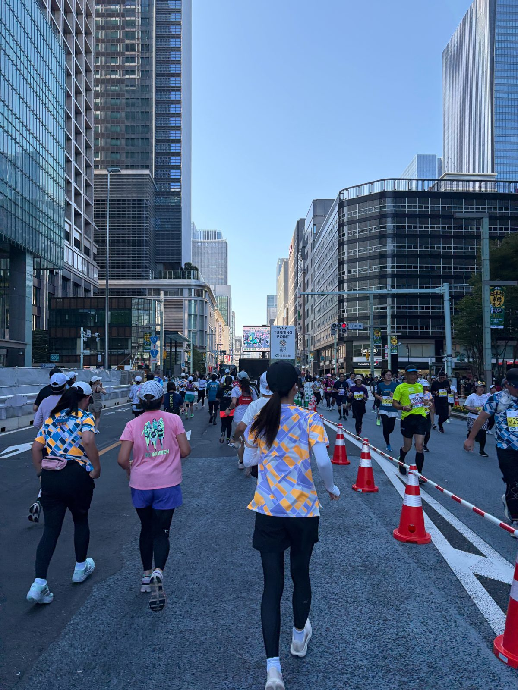
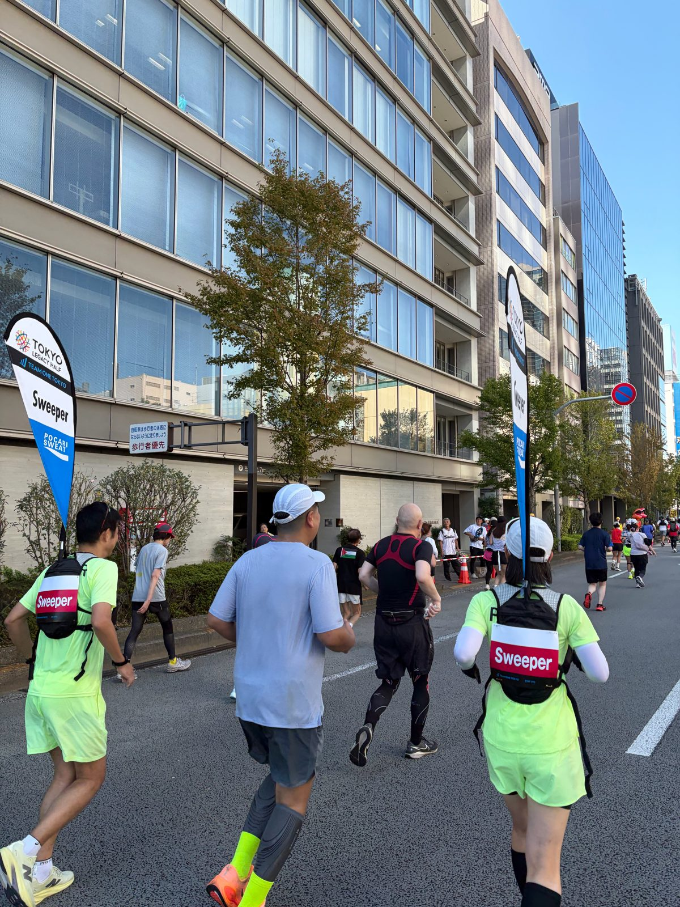
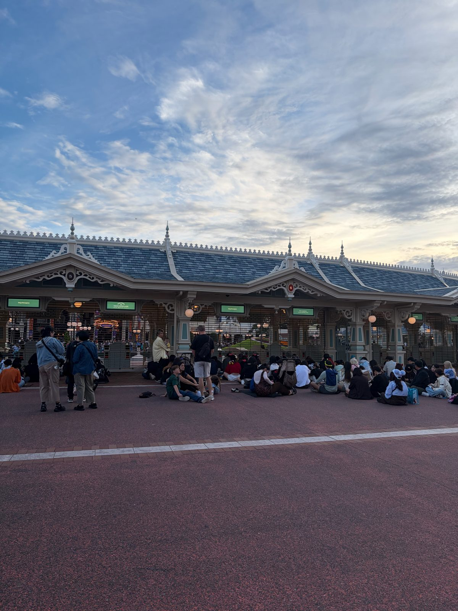
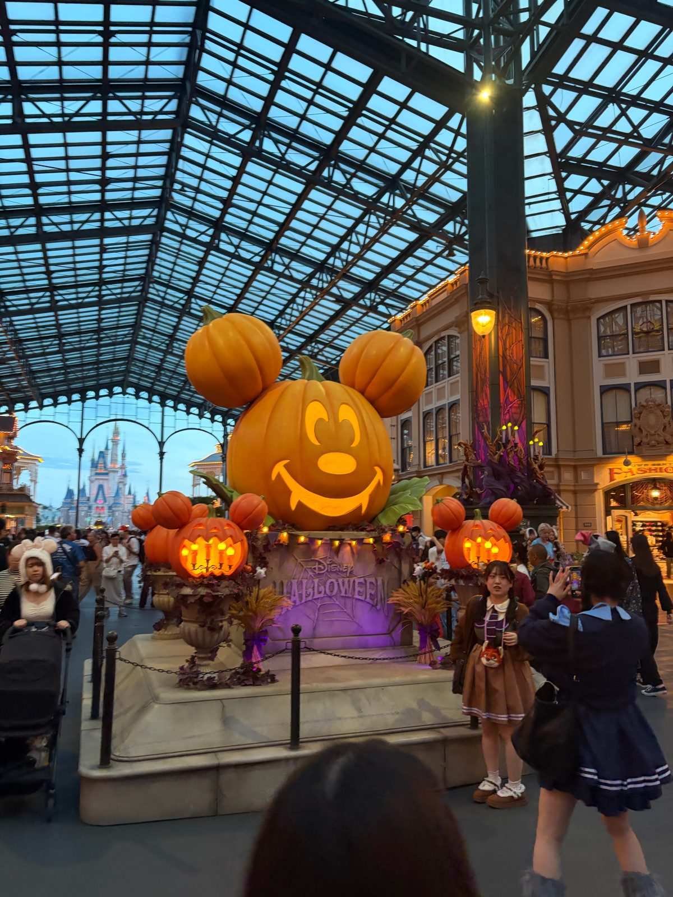
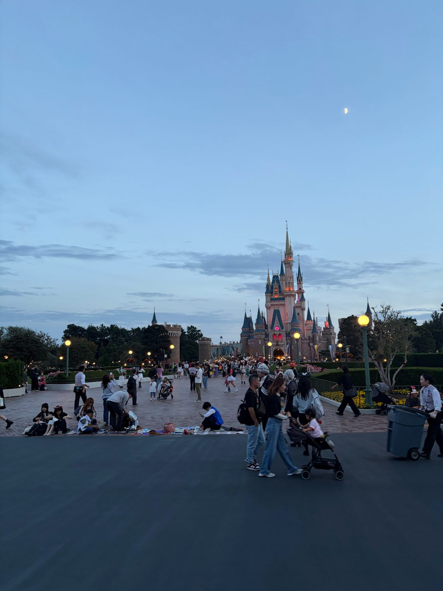
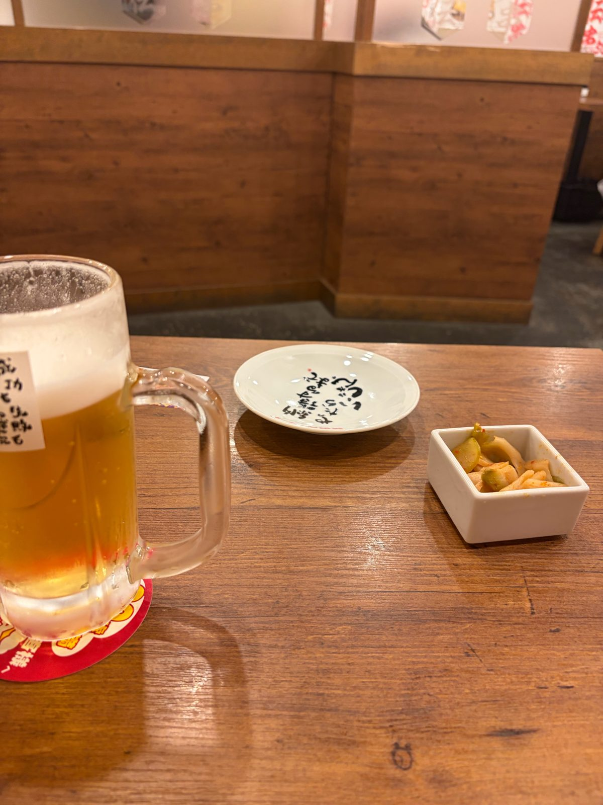
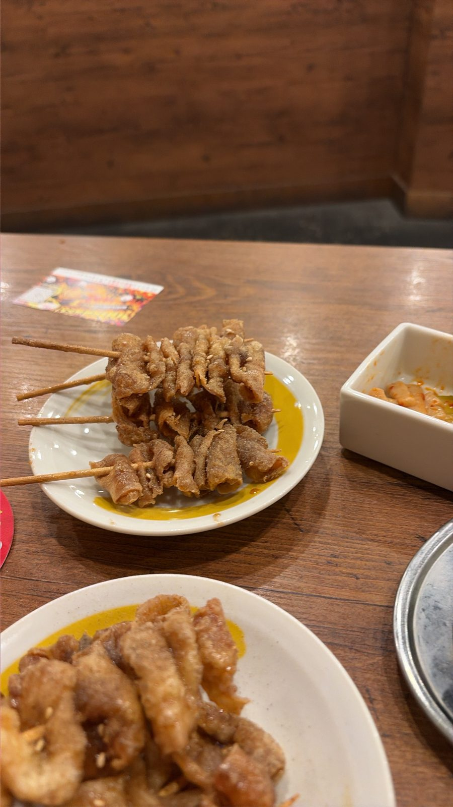

ถ้าเพิ่ง DNF ครั้งแรกในชีวิตมาเมื่อวาน วันนี้คุณจะทำอะไร?

ผมเลือกไป Tokyo Disneyland

## 19.41 กิโลที่ไม่ถึงเส้นชัย

คืนก่อนวิ่ง Tokyo Legacy Half ผมนอนไม่ค่อยหลับ เป้าที่คิดไว้คือ pace 7:05 ต่อกิโล ถ้าถือได้ครบ 21.0975 กิโล จะจบราว 2 ชั่วโมง 29 นาที (ตัวเลขนี้ผมคำนวณเอง)

วันจริงนาฬิกาขึ้น 2:29:37 แทบตรงกับเวลาที่คิดไว้ แต่ระยะตามนาฬิกาอยู่ที่ 19.41 กิโล

| | เป้า | วันจริง |
|---|---|---|
| ระยะ | 21.0975 กม. | 19.41 กม. ตามนาฬิกา |
| เวลา | ราว 2:29 | 2:29:37 |
| pace เฉลี่ย | 7:05 /กม. | 7:43 /กม. |

ช่วงแรกผมได้ราว 7:15 แต่ไม่มีกิโลไหนแตะ 7:05 เลย พอท้ายๆ ก็หลุดไปเกิน 8 นาที หัวใจเฉลี่ย 175 bpm และเกือบ 80% ของเวลาอยู่โซน 171 ขึ้นไป pace ช้ากว่าเป้า แต่หัวใจทำงานหนักเกือบตลอดทาง

ผมไม่ได้หยุดวิ่ง แค่ช่วงท้ายเจอเนินแล้วเดิน ชะล่าใจ กะเวลาผิด แถมยังใช้นาฬิกาไม่คล่อง กว่าจะรู้ตัวแล้ว sprint ไปจุด cut-off สุดท้ายที่ป้ายกิโล 19.1 ของสนาม ก็ช้าไปราว 2 นาที (ส่วนนาฬิกาผมจับระยะได้ 19.41 กิโล)

DNF แรกในชีวิต เจ็บใจน่ะ

## มองย้อนกลับไป

พอนั่งนึกดีๆ มันไม่ได้พลาดเพราะวันนั้นวันเดียว

- **ซ้อมน้อย** ช่วงหลังชอบวิ่งชิวๆ
- **นอนน้อย** มาถึงโตเกียวยังไม่ครบวันดี ก็รับ bib แล้ววิ่งเลย รอบหน้าคงมาล่วงหน้าสัก 2–3 วัน
- **วางแผนไม่ดี** เปิดเร็ว แล้วไม่ได้ดู cut-off แต่ละ checkpoint ช่วงท้ายเลยชิวเกินไป
- **คิดว่าเคยทำได้** แต่เคยทำได้ ก็ไม่ได้แปลว่าจะได้เสมอไป

ร่างกายหลังจบไม่ได้แย่ มีแค่ตึงๆ น่อง เสียดายที่ไม่ได้พกสเปรย์ ของกินก็พกมาน้อยไปหน่อย ถ้าใส่สุดตัวอาจจะจบ แต่คงเจ็บ ไม่เป็นไร ถือว่ามาเที่ยว ได้ long run ไปหนึ่งครั้ง

ที่เจ็บใจที่สุดคือตอนเห็นคนอื่นดีใจ ถ่ายรูปกับเหรียญ เอาจริงผมไม่เคยนึกถึงความรู้สึกนี้เลย จนมาโดนกับตัว เอาเถอะ ผิดหวังบ้างก็ดี **จะได้รู้ว่าพอโอกาสมาถึง เราควรเตรียมตัวให้พร้อมกว่านี้**

## ตั๋วหลังห้าโมงเย็น

ผมนอยอยู่พักใหญ่ แล้วก็นึกขึ้นได้ว่าเคยเห็นคนไป Tokyo Disneyland หลังห้าโมงเย็น ทริปนี้ก็ไม่ได้แพลนไปไหนต่ออยู่แล้ว เช้าวันถัดมาเลยกดตั๋ว After 5 Passport ราคา ¥6,600 ถูกกว่าตั๋ว 1-Day ปกติของวันธรรมดาสัปดาห์นั้นที่ ¥10,900 อยู่สี่พันกว่าเยน และกดได้จากเว็บเท่านั้น

ตั้งใจแค่ว่าไปนั่งดูพาเหรดกับพลุก็พอ

นี่เป็นครั้งแรกที่ผมได้มา Tokyo Disneyland แต่เป็น Disney ครั้งที่สอง ครั้งแรกคือที่ฮ่องกงกับพี่ฟิวส์ ตอนนั้นผมไม่ได้อินกับ character เท่าไหร่ เลยตื่นสาย ขณะที่คนอื่นไปกันแต่เช้า เล่นไปไม่กี่เครื่อง แล้วเห็นคิวหนึ่งไม่ยาว ต่อไปถึงหน้าสุดถึงรู้ว่าเป็นคิวถ่ายรูปกับ Ironman เลยได้ภาพคู่มางงๆ กลับบ้านมาหนึ่งใบ

รอบนี้ผมอยากรู้ว่า magic moment ที่ใครๆ พูดถึง มันจะแค่ไหนกันเชียว

## เข้าไปแล้วหลุดไปอีกโลก

ไปถึงก็ตามคาด คนรอเยอะมาก นั่งพื้นรอกันเหมือนตอนรอปล่อยตัววิ่งเมื่อวาน

หลายคนแต่งตัวจัดเต็มตามตัวละครที่ตัวเองรัก ยังไม่ทันเข้าประตู ผมก็เริ่มรู้สึกแล้วว่ากำลังจะหลุดไปอีกโลกหนึ่ง

คืนนั้นผมได้เล่น

- **Pirates of the Caribbean** มีจังหวะให้ตกใจตั้งแต่ช่วงแรก บรรยากาศหลอน หุ่นทำเหมือนจริงมาก หมาแมวขยับหางเหมือนมีชีวิต
- **หนัง 3D** น่าจะเคยดูแล้วที่ฮ่องกง แต่รอบนี้ชอบโมเมนต์ที่เด็กๆ กระโจนดีใจ เอื้อมมือไปจับของที่ลอยออกมา จนแม่ต้องคอยห้ามเพราะจะไปโดนหัวคนแถวหน้า
- **It's a Small World** เพลงเพราะ แต่ละโซนเล่าเพลงตามประเทศและธีมของตัวเอง เดินออกมายังได้ยินคนฮัมตาม
- **Peter Pan** ล่องเรือเหมือนกัน ฟีลคล้าย Pirates

ดูเด็กๆ ในโรงหนังแล้วผมก็สงสัยว่า พอโตขึ้น ความกล้าและความสนุกแบบตอนเด็กมันจางหายไปตอนไหนกันนะ?

## พาเหรด และ Let It Go

ออกจาก Peter Pan ก็ใกล้เวลาพาเหรด ผมเห็นโซนที่คนถือกล้องตัวใหญ่นั่งรอกัน เลยไปนั่งด้วย มุมที่คนถือกล้องใหญ่เลือก ยังไงก็ต้องดี

ไฟสวยมาก เจ้าชายเจ้าหญิงมาตามเรื่องของตัวเอง ทุกคนมีบท สบตาและโบกมือให้คนดูไม่หยุด พอถึงเพลง Let It Go จาก Frozen ไม่รู้สิ มันตื้นตันบอกไม่ถูก น้ำตาซึมไปจนขบวนจบ

**นี่ละมั้ง magic moment ที่ทำให้เราได้กลับไปเป็นเด็กตัวเล็กๆ อีกครั้ง**

หลังพาเหรดผมไปเล่น Roger Rabbit's Car Toon Spin หมุนไปตามทางสนุกดี แล้วปิดท้ายด้วย Star Tours รอบแรกแถวหน้าล็อกเบาะไม่ได้ พนักงานเลยเชิญทุกคนออกมาทั้งรอบ ได้เล่นจริงรอบถัดไป เครื่องโยกจนเหมือนนั่งยานอวกาศจริงๆ

## ไม่มีพลุ แต่คุ้มแล้ว

ออกมาเกือบสองทุ่มครึ่ง คืนนั้นโชคร้าย พลุถูกยกเลิก แต่เอาเถอะ เกือบ 4 ชั่วโมงที่ได้กลับไปเป็นเด็ก ได้หัวเราะ ได้น้ำตาซึม แค่นี้ก็คุ้มแล้ว

ก่อนนอนผมแวะร้านหนังไก่ที่เคยมากินกับอุ้ม เพิ่งรู้ว่าอยู่ใกล้โรงแรมที่พักนี่เอง เดี๋ยวนี้สั่งผ่านมือถือได้แล้ว แต่ชื่อเมนูดูยากหน่อย

เบียร์ไปสองแก้ว ฉลองให้ตัวเองที่ได้มาถึงที่นี่ เมื่อวานยังนอยกับ 19.41 กิโลที่ไม่ถึงเส้นชัยอยู่เลย แต่คืนนี้กลับอิ่มเอมแบบที่ไม่ได้คาดไว้

## เพราะ podcast ตอนหนึ่ง

ที่จริงผมอยากรู้เรื่อง magic moment ตั้งแต่คืนก่อนวิ่งแล้ว คืนที่นอนไม่หลับ ผมปล่อย Spotify รันไปเรื่อยๆ จนไปเจอ NERDsery ของ Salmon Podcast ตอนที่ชวนคุณอูน ชนิสรา มาคุยเรื่อง Disney ฟังไปฟังมาก็เริ่มเข้าใจว่าทำไมคนถึงหลงรัก Disney กันนัก

พอได้ไปเจอเอง ทั้งน้ำตาซึมตอน Let It Go และตอนพนักงานเชิญทุกคนลงจาก Star Tours ผมก็เข้าใจขึ้นอีกนิด ว่าที่คุณอูนพูดถึง magic moment และ safety first มันเป็นแบบนี้นี่เอง

<iframe width="560" height="315" style="max-width:100%" src="https://www.youtube.com/embed/O_50IzTpvB0" title="อูน ชนิสรา : ความสุข-ความเชื่อในจักรวาล Disney | NERDsery EP07" frameborder="0" allow="accelerometer; clipboard-write; encrypted-media; gyroscope; picture-in-picture; web-share" referrerpolicy="strict-origin-when-cross-origin" allowfullscreen></iframe>

ส่วนเส้นชัยที่ค้างไว้ เจอกันที่เฉิงตู

แล้วคุณล่ะ ครั้งล่าสุดที่ได้สนุกแบบเด็กๆ คือเมื่อไหร่?
